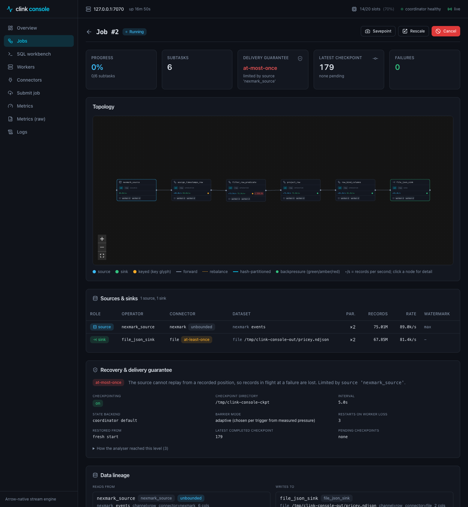
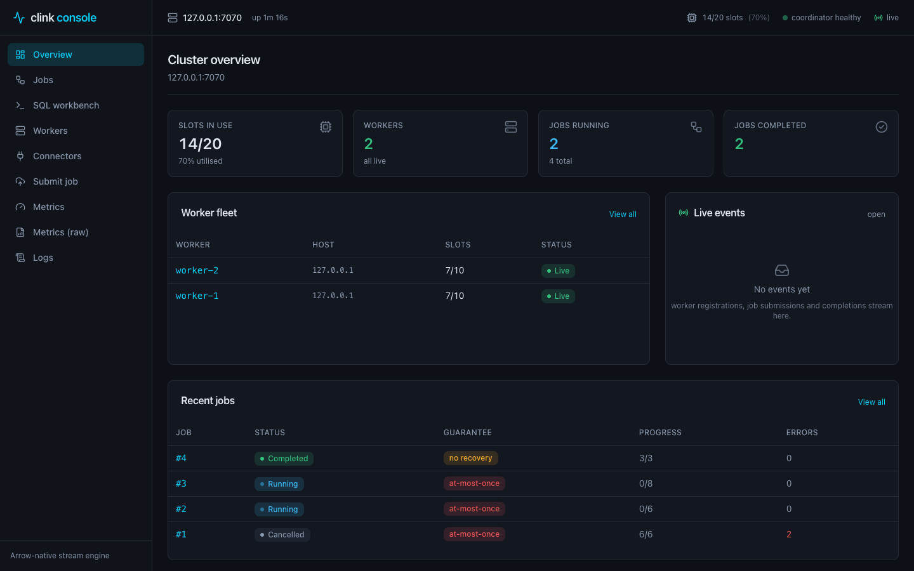
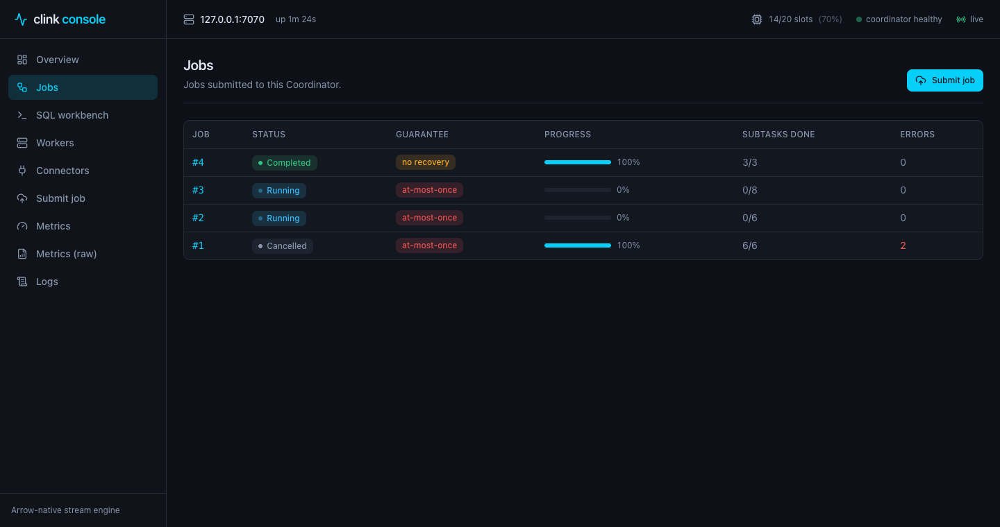
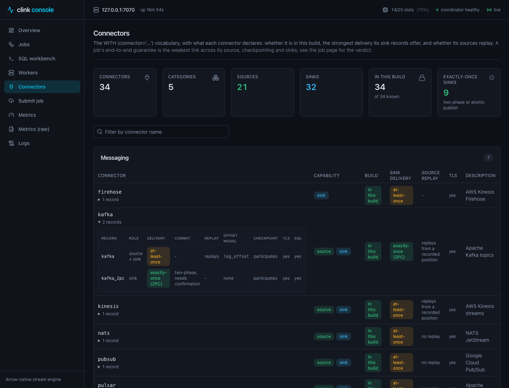
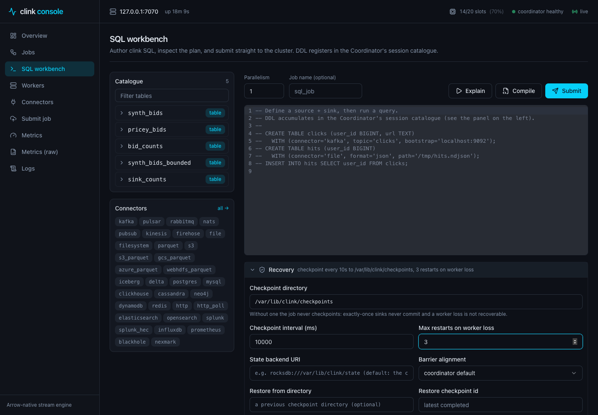
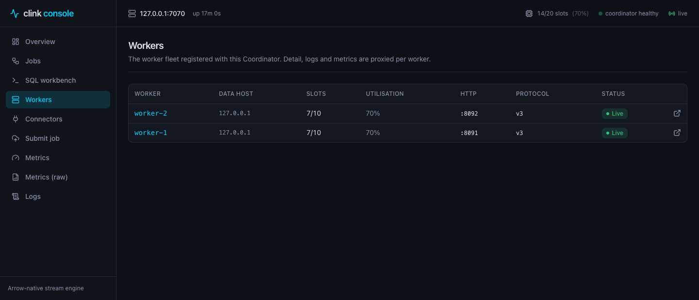

# clink console (clink-fe)

[](https://github.com/orhaugh/clink-fe/actions/workflows/ci.yml)
[](LICENSE)

A modern operations console for [clink](https://github.com/orhaugh/clink)
clusters: Coordinator and Worker visibility, job submission with recovery
options, each job's delivery guarantee and the sources and sinks behind it,
live per-operator DAG overlays, a SQL workbench, data lineage, cluster-wide
logs, metrics dashboards, and job failure inspection.



Built with React + TypeScript + Vite + Tailwind + shadcn-style components, in a
dark ops theme. It talks only to clink's existing HTTP API; there is no separate
backend.

**Ships inside clink.** From clink 0.14.0 every clink release carries this
console, and a Coordinator serves it at `/` on its HTTP port, so most people
never install it separately: open `http://<coordinator>:8081`, or start
clink's [quickstart](https://github.com/orhaugh/clink/tree/main/examples/quickstart).
This repository is where the console is developed and released; clink pins
a release of it. The console is a pure frontend for clink's coordinator HTTP
API, so the steps below need a running clink cluster.

## Running

By default clink's HTTP server sends no CORS headers, so the browser must reach
it same-origin. In dev the Vite server proxies `/api` and `/metrics` to a
running Coordinator (cross-origin deployments can instead start the node with
`--http-cors-origin=<origin>`).

1. Start a Coordinator with a fixed HTTP port:

   ```bash
   clink_node --role=coordinator --port=7070 --http-port=8081
   # and one or more Workers, each with their own HTTP port:
   clink_node --role=worker --id=worker-1 --coordinator-host=127.0.0.1 --coordinator-port=7070 --http-port=8091
   ```

2. Point the console at it and run:

   ```bash
   cp .env.example .env        # edit VITE_CLINK_TARGET if not :8081
   npm install
   npm run dev                 # http://localhost:5181
   ```

The Coordinator is the single entry point: it proxies per-Worker routes
(`/api/v1/workers/:id/*`), so the console only needs the coordinator target. Workers must
be started with `--http-port` for their detail/logs/metrics to be reachable
through the coordinator proxy.

Alternatively, skip the dev proxy and point the console straight at the coordinator by
enabling CORS on the node:

```bash
clink_node --role=coordinator --port=7070 --http-port=8081 --http-cors-origin='*'
```

## Production: inside every clink release

Each tag here publishes the built console as a release asset,
`clink-console-vX.Y.Z.tar.gz` with its `.sha256`, from
[`release.yml`](.github/workflows/release.yml). clink pins one of them (the
version and the checksum, in its `scripts/console.env`), installs it at
`share/clink/console` in its SDK tarball and its runtime image, and a
Coordinator with an HTTP port serves it beside the JSON API: one port, no
web server, no CORS setup. `--http-static-dir=<dir>` on the Coordinator serves
a different build instead, for example this repository's `dist/`:

```bash
npm run build
clink_node --role=coordinator --port=7070 --http-port=8081 --http-static-dir=$PWD/dist
open http://localhost:8081
```

`--no-console` serves none. A Coordinator started with `CLINK_AUTH_TOKEN`
serves the console's own files without the token, since they hold no cluster
data; the console asks for the token on the first request the API refuses,
keeps it for the browser tab only, and sends it on every request, the live
event stream included. The sidebar shows the console's version beside the
engine's.

The `ghcr.io/orhaugh/clink-console` image this repository used to publish is
retired: it paired the console with clink 0.4.0 and was rebuilt only when the
console was released, never when clink was.

## What it shows

- **Overview** - cluster rollup (slots, jobs), Worker fleet, recent jobs with
  their status and delivery guarantee, and a live event feed (SSE).
- **Workers** - the fleet with each worker's cluster protocol version (a
  mixed-version fleet is called out), plus per-worker detail: running
  subtasks, config, parsed metrics, and logs.
- **Jobs** - submitted jobs with the coordinator's own status and the
  end-to-end delivery guarantee its analyser computed at submit. Per job: the
  topology with live overlays, a **sources & sinks** table (the connector each
  endpoint was built on and the delivery it declares, the dataset it reads or
  writes, parallelism, live throughput and watermark), the **recovery
  configuration the job actually runs with** (checkpoint directory and
  interval, state backend, barrier mode, restarts, restore source) with the
  guarantee, what limits it and the analyser's reasoning, data lineage,
  structured per-subtask failures with stack traces, and savepoint / rescale /
  cancel actions.
- **SQL workbench** - author clink SQL in a dialect-aware editor with
  catalogue-driven autocomplete, browse the session catalogue and the connector
  vocabulary, set the job's recovery options, and Explain (see the logical
  plan), Compile (see the JobGraphSpec) or Submit (run it on the cluster). See
  [Sample SQL](#sample-sql-for-the-workbench).
- **Connectors** - the `WITH (connector='...')` vocabulary, grouped by
  category, with what the running coordinator declares for each: whether it
  is in this build, the strongest delivery its sink records offer, whether its
  sources replay, TLS, and the capability records themselves.
- **Submit** - upload a compiled job `.so` (multipart) or post a JSON job spec,
  each with its recovery options (checkpoint directory and interval, state
  backend, restarts on worker loss, barrier alignment, restore source).
- **Logs** - cluster-wide log explorer with level / source / since filters and
  follow mode, aggregating the coordinator and every Worker.
- **Metrics** - purpose-built dashboards over the coordinator Prometheus feed
  (checkpoints, state & disaggregation, connectors, SQL pipeline, resilience,
  orchestration, process / system), plus a searchable raw metric-family
  explorer. System cards also appear on each Worker's metrics tab.

## Screenshots

Taken against a local two-worker cluster built from clink `main`, with a
checkpointed SQL job and one without checkpointing, so the guarantee column
shows both outcomes.

|                                                                                                              |                                                                                                             |
| ------------------------------------------------------------------------------------------------------------ | ----------------------------------------------------------------------------------------------------------- |
|  Overview: fleet, live events, recent jobs with their guarantee    |  Jobs: the coordinator's status and each job's delivery guarantee         |
|  Job detail: topology, sources & sinks, recovery and guarantee |  Connectors: availability, declared delivery, replay, records |
|  SQL workbench with the recovery options                 |  Workers with their protocol versions                               |

## Sample SQL for the workbench

Paste these into the **SQL workbench** (`/sql`). Notes:

- **Explain** binds and plans the trailing `SELECT` / `INSERT` (no cluster
  resources needed); **Compile** returns the `JobGraphSpec`; **Submit** runs it.
- A bare `SELECT` works with **Explain** only - wrap it in `INSERT INTO <sink>`
  to Compile or Submit.
- DDL accumulates in the Coordinator's **session catalogue**, so run the setup
  once; the queries then resolve against it. The setup uses `IF NOT EXISTS`, so
  it is safe to re-run.
- To **Submit** a job that needs no external setup, use the synthetic `nexmark`
  source in the first group below. The Kafka examples after it need a reachable
  broker to Submit (Explain and Compile work without one).
- Windowed aggregation needs an `event_time_column` on the source. Window sizes
  take an `INTERVAL` (or a plain millisecond integer, e.g. `TUMBLE(datetime, 10000)`).
- The full connector vocabulary is on the **Connectors** page; swap `connector`,
  `brokers`, `topic`, `path`, etc. for your environment.

### Runs with no external connector (synthetic data)

The built-in `nexmark` source generates a synthetic event stream - no Kafka, no
files. `events_num` bounds it (the job then completes), `tps` sets the
event-time spacing, and `nexmark_type` picks the shape (`bid`, `auction`,
`person`). Paired with the `blackhole` sink (which discards output) this runs
end to end with zero external setup - press **Submit** and watch it on the Jobs
page.

Bounded windowed count (completes):

```sql
CREATE TABLE IF NOT EXISTS synth_bids (
  auction BIGINT, bidder BIGINT, price BIGINT, channel VARCHAR, url VARCHAR, datetime BIGINT
) WITH (connector='nexmark', format='json', nexmark_type='bid',
        event_time_column='datetime', watermark_lag_ms='1000',
        events_num='50000', tps='10000');

CREATE TABLE IF NOT EXISTS sink_counts (bidder BIGINT, bid_count BIGINT)
  WITH (connector='blackhole');

INSERT INTO sink_counts
SELECT bidder, COUNT(*) AS bid_count
FROM synth_bids
GROUP BY TUMBLE(datetime, INTERVAL '5' SECOND), bidder;
```

Stateless passthrough + filter (also completes):

```sql
CREATE TABLE IF NOT EXISTS sink_bids (bidder BIGINT, price BIGINT)
  WITH (connector='blackhole');

INSERT INTO sink_bids SELECT bidder, price FROM synth_bids WHERE price > 500;
```

> The demo `docker compose` stack auto-submits an unbounded stream that competes
> for the containers' CPU. Cancel that job on the **Jobs** page first, or your
> synthetic job may run very slowly (or appear to stall) while it is starved of
> CPU. Set `events_num='0'` for an unbounded stream; to inspect output instead
> of discarding it, swap `blackhole` for `connector='file'` / `'parquet'` with a
> `path=` inside the Worker container.

### Realistic examples (Kafka - Submit needs a reachable broker)

These mirror the in-repo nexmark queries. **Explain** and **Compile** work
without a broker; **Submit** needs one reachable from the Workers - use the
compose service name (e.g. `kafka:9092`), not `localhost`, from inside a
container.

### 1. Setup - define the source tables (run once)

```sql
CREATE TABLE IF NOT EXISTS bids (
  auction BIGINT, bidder BIGINT, price BIGINT, channel VARCHAR, datetime BIGINT
) WITH (connector='kafka', format='json', brokers='localhost:9092', topic='bids',
        event_time_column='datetime', watermark_lag_ms='4000');

CREATE TABLE IF NOT EXISTS auctions (
  id BIGINT, seller BIGINT, category BIGINT, datetime BIGINT, expires BIGINT
) WITH (connector='kafka', format='json', brokers='localhost:9092', topic='auctions',
        event_time_column='datetime', watermark_lag_ms='4000');
```

### 2. Filter + projection (Explain)

```sql
SELECT auction, bidder, price FROM bids WHERE price > 100;
```

### 3. Tumbling-window aggregation (Explain)

Bids per bidder in 10-second event-time windows:

```sql
SELECT bidder, COUNT(*) AS bid_count
FROM bids
GROUP BY TUMBLE(datetime, INTERVAL '10' SECOND), bidder;
```

### 4. Hopping + session windows (Explain)

```sql
-- 5s window sliding every 1s
SELECT channel, SUM(price) AS total
FROM bids
GROUP BY HOP(datetime, INTERVAL '5' SECOND, INTERVAL '1' SECOND), channel;

-- 30s inactivity-gap sessions
SELECT bidder, COUNT(*) AS n
FROM bids
GROUP BY SESSION(datetime, INTERVAL '30' SECOND), bidder;
```

### 5. Stream-stream join (Explain)

Join each bid to its auction; the join output flattens columns to
`<alias>_<column>` (so `bids AS B` gives `b_auction`, `b_price`, ...):

```sql
SELECT b_auction, a_seller, b_price
FROM bids AS B JOIN auctions AS A ON B.auction = A.id
WHERE b_datetime >= a_datetime AND b_datetime <= a_expires;
```

### 6. Logical view with a column-alias list (Explain)

A view is pure query rewrite (no storage); the alias list renames its outputs:

```sql
CREATE OR REPLACE VIEW pricey (auc, amount) AS
  SELECT auction, price FROM bids WHERE price > 1000;

SELECT auc, amount FROM pricey;
```

### 7. Submit a job end to end (Compile / Submit)

A complete `INSERT INTO <sink>` - works in all three modes:

```sql
CREATE TABLE IF NOT EXISTS bid_counts (bidder BIGINT, bid_count BIGINT)
  WITH (connector='kafka', format='json', brokers='localhost:9092', topic='bid-counts');

INSERT INTO bid_counts
SELECT bidder, COUNT(*) AS bid_count
FROM bids
GROUP BY TUMBLE(datetime, INTERVAL '10' SECOND), bidder;
```

### 8. Schema evolution (DDL, no job)

ALTER / SET / RENAME mutate the session catalogue in place; watch the catalogue
sidebar update:

```sql
ALTER TABLE bids ADD COLUMN url VARCHAR;
ALTER TABLE bids SET (group_id='workbench-demo');
ALTER TABLE bids RENAME COLUMN channel TO channel_name;
```

For a fully offline example (no Kafka needed, Submit included), swap the source
and sink for the `file` connector, e.g.
`WITH (connector='file', format='json', path='/tmp/in.ndjson')`.

## API source of truth

See `docs/clink-api.md` for the exact endpoint and JSON-shape reference the
typed client in `src/lib/` is built against. Savepoint, rescale, structured
subtask failures (with capture-site traces where the engine build supports
them), the recovery parameters on submit, and each job's checkpoint
configuration and delivery guarantee are all served over HTTP; metrics remain
Prometheus text. Fields a coordinator does not report (one older than the
console) render as a dash rather than a guessed value: the guarantee, the
recovery configuration, the connector capability records and the recovery
options on the `.so` upload route need a clink newer than 0.11.0; the job
status and worker protocol version are older.

## Build

```bash
npm run typecheck
npm run build
```
